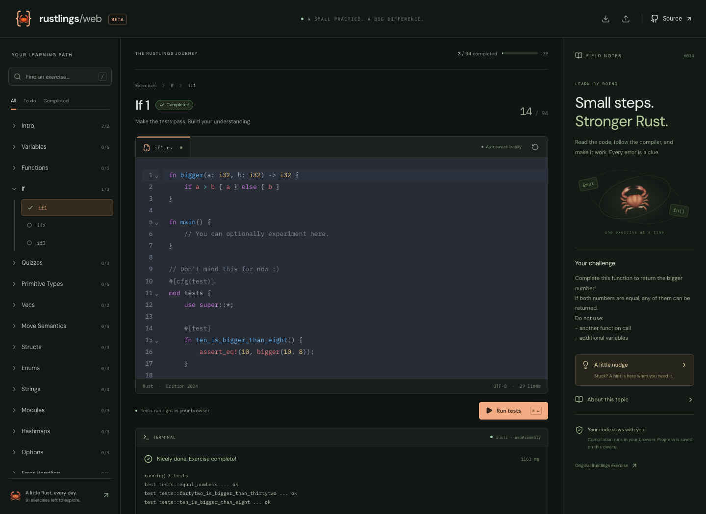

# Rustlings Web 🦀

A little Rust, every day. A Next.js + TypeScript workbench for the official Rustlings exercises, with a **real Rust compiler running in your browser** and progress stored in **localStorage**.

No account, database, API keys, or compilation server.



## Run locally

Requires Node.js 22+, npm, and `tar` with Zstandard support (macOS includes this; on Linux, install `zstd` if needed).

```sh
git clone https://github.com/petreleon/rustlings-web.git
cd rustlings-web
npm ci
npm run dev
```

Open the localhost URL printed by Next.js. The first development start downloads and verifies the compiler archives. Run `npm run compiler:prepare` to do this separately.

```sh
npm test                 # Progress persistence and verification regressions
npm run typecheck
npm run build            # Prepares compiler assets and exports the app to out/
npm start                # Preview the static production app on localhost:3100
```

Equivalent Make targets: `make setup`, `make dev`, `make test`, `make build`, `make preview`.

## The workbench

- All **94 exercises from Rustlings v6.5.0**, organized by topic, with search, hints, topic notes, and links to the original source.
- CodeMirror editor with Rust syntax highlighting, line numbers, indentation, search, and undo.
- Compile and execute programs, or compile and run the exercise's Rust test harness.
- Real compiler diagnostics with clickable source locations.
- Automatic local draft saving, completion tracking, last exercise restoration, and JSON backup export/import.
- Editing a completed solution clears its completion; stale compiler results cannot complete newer code.
- Responsive desktop and mobile layouts, keyboard navigation, and reduced-motion support.
- `⌘/Ctrl + Enter` runs the current exercise; `Escape` stops execution; `/` focuses exercise search.

## How compilation works

The compiler is the experimental [Weblings](https://github.com/AngelOnFira/weblings) toolchain: `rustc → Cranelift → Waffle → WASM linker → WebAssembly executable`. The compiler itself is WebAssembly, and executes in a dedicated browser Worker using an in-memory WASI filesystem. User source code is never sent to a compilation service.

[`toolchain.lock.json`](toolchain.lock.json) pins the [wasm-rustc](https://github.com/AngelOnFira/wasm-rustc) release, archive SHA-256 hashes, and extracted asset hashes. `scripts/prepare-compiler.mjs` verifies the downloads, extracts only the compiler and WASI sysroot bundle, and verifies previously prepared assets before reuse. The browser also verifies downloaded/cached asset hashes and replaces corrupt cache entries. Large binaries and archive caches are ignored by Git and prepared during development/build.

On the first run, the browser loads approximately **152 MiB** of uncompressed compiler and standard-library assets. HTTP compression can reduce transfer size. Assets are cached with the browser Cache API; memory use is substantially larger than the download, so a current desktop browser is recommended. No SharedArrayBuffer or cross-origin isolation headers are required. The compiler loads only when you run an exercise.

Compilation/execution stops after 30 seconds, output is capped at 1 MB, and Stop terminates the worker. Compiler asset loading has a separate three-minute timeout. Programs have an in-memory filesystem, no host filesystem access, and no networking implementation.

### Browser limitations

This is an experimental WASM compiler, not a complete desktop Rust installation. It has the bundled standard library; arbitrary Cargo dependencies, native OS APIs, and external crates are unavailable.

- **Threads (`threads1–3`, `arc1`)**: type-checking is available. Actual thread execution requires native Rustlings.
- **Clippy (`clippy1–3`)**: compilation and execution are available. The browser toolchain does not include Clippy, so lint verification requires native Rustlings.
- These exercises remain browsable and editable, but are not marked complete from a partial browser check.
- **Backend code generation**: upstream reference solutions for `hashmaps3`, `errors5`, `errors6`, `iterators4`, `from_into`, `from_str`, and `try_from_into` hit unimplemented integer operations in this compiler backend. The app automatically falls back to an explicitly labeled type-check when this happens. It preserves the compiler error and does not award completion for a type-check. Other solutions can still be executed if they avoid the unsupported operations.
- Test exercises require a successful test harness with at least one passing test. Removing all tests does not count as completion. This is a personal learning tool; it is not a secure grading system.

Chromium verification ran **80 upstream reference solutions successfully** through actual WebAssembly compilation/execution. The remaining 14 exercises have the limitations listed above (4 thread-based, 3 Clippy, 7 backend-sensitive). This does not establish compatibility for every possible Rust program. See [verification details](docs/verification.md).

## Progress and privacy

Progress uses the versioned key `rustlings-web:progress:v1`. Drafts, completion records tied to the exact source, and the selected exercise stay in your browser. There is no backend synchronization or telemetry. Fonts and runtime assets are self-hosted.

Clearing site data clears your work; private browsing may restrict persistence. Use **Export progress** for backups or to move to another browser. **Import progress** validates file size, schema, exercise IDs, release identity, and completion consistency before replacing local work with confirmation. Exported files contain your code.

## Exercise provenance and updates

Exercises, hints, and topic README files are bundled from [rust-lang/rustlings v6.5.0](https://github.com/rust-lang/rustlings/tree/v6.5.0), commit `2af9e89ba536fad01aa828b06e0ac2174bad0f6d`. Source files are preserved without rewriting; browser-specific guidance is presented separately. Solutions are not bundled with the app. This is an independent project, not an official Rustlings frontend.

```sh
npm run exercises:sync
# Or use an existing checkout at the pinned commit:
npm run exercises:sync -- /path/to/rustlings
```

The sync script verifies the upstream commit and copies its MIT license. Updating Rustlings intentionally requires changing the pinned version and commit in the script, rerunning sync, checking compatibility, and considering progress migration. The app does not fetch a moving GitHub branch at runtime.

## Hosting

`npm run build` produces a static `out/` directory. Serve it over HTTPS (or localhost) with Web Workers, WASM, and the Cache API enabled. Preserve all `compiler/` files. A backend is unnecessary. The included CI workflow checks types, regression tests, dependency advisories, compiler checksums, and the production build on GitHub-hosted runners.

For a subdirectory deployment, set the build-time base path:

```sh
NEXT_PUBLIC_BASE_PATH=/rustlings-web npm run build
NEXT_PUBLIC_BASE_PATH=/rustlings-web npm start
```

This repository is ready for static hosting; creating the GitHub repository does not itself deploy a public website.

## Licenses and acknowledgments

Application: [MIT](LICENSE). Rustlings: [MIT](public/licenses/RUSTLINGS-MIT.txt), copyright Carol (Nichols || Goulding). Compiler worker adapted from Weblings, copyright Forest Anderson. Compiler artifacts are provided by wasm-rustc, with Rust components under MIT/Apache-2.0 and their respective upstream licenses.

See [THIRD_PARTY_NOTICES.md](THIRD_PARTY_NOTICES.md) and [`public/licenses/`](public/licenses/) for attribution and included license texts. Thank you to the Rustlings, Weblings, rustc, Cranelift, Waffle, and browser_wasi_shim contributors.
